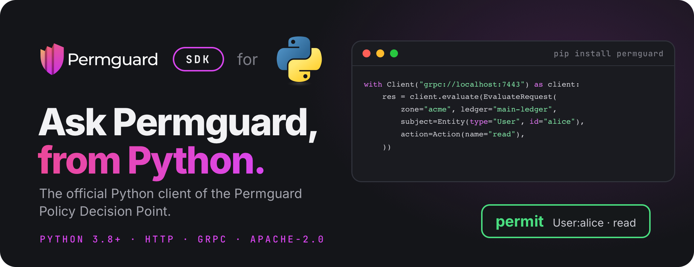

<!--
Copyright (c) 2022 Nitro Agility S.r.l.
SPDX-License-Identifier: Apache-2.0
-->

# Permguard Python SDK

[](https://pypi.org/project/permguard/)
[](https://github.com/permguard/sdk-python/actions/workflows/sdk-python-ci.yml)
[](https://www.apache.org/licenses/LICENSE-2.0)

<p align="center">
  
</p>

<p align="center">
  <a href="https://github.com/permguard/permguard"><b>Permguard</b></a> ·
  <a href="https://docs.permguard.com/"><b>Documentation</b></a> ·
  <a href="#install"><b>Install</b></a> ·
  <a href="#quick-start"><b>Quick start</b></a> ·
  <a href="#develop"><b>Develop</b></a>
</p>

**The official Python client of the Permguard Policy Decision Point.**

Before your code acts, it asks Permguard whether a subject may perform an action on a resource, and Permguard answers from the policies of a ledger.
This SDK is how Python code asks: one synchronous client for the native, stateless PDP interface `permguard.api.pdp.native.v1`, over HTTP/JSON or gRPC, with the same request and the same answer on both.

<p align="center">
  
</p>

<p align="center"><sub>Your code asks, the SDK carries the question, the data plane decides with the ledger's policies.</sub></p>

## Install

The SDK needs Python 3.8 or newer, and is published on PyPI.

```bash
pip install permguard
```

With uv, `uv add permguard`; with Poetry, `poetry add permguard`.
It needs a Permguard data plane to ask: by default it listens on port `7443`, for HTTP and gRPC alike.
See the [Permguard repository](https://github.com/permguard/permguard) to run one.

## Quick start

```python
from permguard import Action, Client, Entity, EvaluateRequest, Refusal

request = EvaluateRequest(
    zone="acme",
    ledger="main-ledger",
    profile="gateway",
    subject=Entity(type="User", id="alice"),
    resource=Entity(type="Document", id="budget-2026"),
    action=Action(name="read"),
    request_id="example-1",
)

try:
    # grpc:// or grpcs:// speaks gRPC; http:// or https:// speaks JSON.
    with Client("grpc://localhost:7443") as client:
        response = client.evaluate(request)
except Refusal as refusal:
    raise SystemExit(f"refused: class={refusal.error_class} code={refusal.code} message={refusal.message}")

print("permitted:", response.decision)
```

The same program is in [examples/cmd](examples/cmd/check.py); set `PERMGUARD_PDP_URL` to point it at another data plane.

### The request

| Field              | What it says                                                            |
| ------------------ | ----------------------------------------------------------------------- |
| `zone`, `ledger`   | the ledger whose policies decide, in its zone                           |
| `profile`          | the profile of the ledger's manifest that selects the partitions to run |
| `subject`          | who asks: a type and an id, with optional properties                    |
| `resource`         | what is acted on: a type and an id, with optional properties            |
| `action`           | what is done: a name, with optional properties                          |
| `context`          | any other fact the policies read                                        |
| `partition_inputs` | runtime data for the partitions of the profile, see below               |
| `request_id`       | your id for the call, given back in the answer                          |

### The answer

A deny is not an exception: it is a successful response whose `decision` is `False`.
Validation, authorization, availability and server failures raise `permguard.Refusal`, with their stable `error_class` and `code`.

## Partition inputs

Runtime data is addressed to the partition name the ledger's profile declares:

```python
from permguard import PartitionInput

request.partition_inputs["authorization"] = PartitionInput(
    type="permguard.cedar.entities.v1",
    data=[
        {
            "uid": {"type": "Team", "id": "engineering"},
            "attrs": {"active": True},
            "parents": [],
        }
    ],
)
```

The key selects a partition the profile already declares.
The input `type` is checked against that declaration; it does not select a runtime.

## Many evaluations at once

Set the defaults on the request, list the `evaluations`, and call `evaluate_many`:

```python
from permguard import (
    Action,
    Entity,
    EvaluateRequest,
    Evaluation,
    EvaluationOptions,
    EvaluationsSemantic,
)

response = client.evaluate_many(
    EvaluateRequest(
        zone="acme",
        ledger="main-ledger",
        subject=Entity(type="User", id="alice"),
        evaluations=[
            Evaluation(
                resource=Entity(type="Document", id="budget-2026"),
                action=Action(name="read"),
                request_id="read",
            ),
            Evaluation(
                resource=Entity(type="Document", id="budget-2026"),
                action=Action(name="update"),
                request_id="update",
            ),
        ],
        options=EvaluationOptions(
            evaluations_semantic=EvaluationsSemantic.EXECUTE_ALL,
        ),
    )
)
```

Each evaluation inherits what it does not set from the request.

## Endpoints and options

| Endpoint   | Transport                                      |
| ---------- | ---------------------------------------------- |
| `http://`  | JSON over HTTP                                 |
| `https://` | JSON over HTTPS                                |
| `grpc://`  | `permguard.data.v1.PolicyDecisionPoint`        |
| `grpcs://` | `permguard.data.v1.PolicyDecisionPoint` on TLS |

```python
with Client(
    "https://pdp.example.com",
    timeout=5.0,
    headers={"authorization": f"Bearer {token}"},
) as client:
    configuration = client.get_configuration()
```

| Keyword            | Sets                                                |
| ------------------ | --------------------------------------------------- |
| `timeout`          | the timeout of every call, in seconds, 5 by default |
| `headers`          | static headers, also sent as gRPC metadata          |
| `tls_context`      | the `ssl.SSLContext` for `https://`                 |
| `grpc_credentials` | the `grpc.ChannelCredentials` for `grpcs://`        |

Every call also takes its own `timeout`.
`get_configuration` reads the data plane's discovery document.
The client reuses its HTTP connection or gRPC channel: use it as a context manager, or call `close()`.

## Compatibility

This major version implements `permguard.api.pdp.native.v1`.
Compatibility is tied to that versioned interface, not to a server minor release.

## Develop

```bash
hatch run protoc
hatch run dev
hatch -e lint run all
hatch build
```

A release tag publishes to PyPI.
The package version is read from `permguard/__about__.py` and set from the release tag.

## License

Apache License 2.0: see [LICENSE](LICENSE), [NOTICE.md](NOTICE.md) and [THIRD_PARTY_NOTICES.md](THIRD_PARTY_NOTICES.md).

Permguard is a trademark of Nitro Agility S.r.l., see [TRADEMARKS.md](TRADEMARKS.md).
Python and the Python logos are trademarks of the Python Software Foundation, shown only to name the language this SDK is for.
